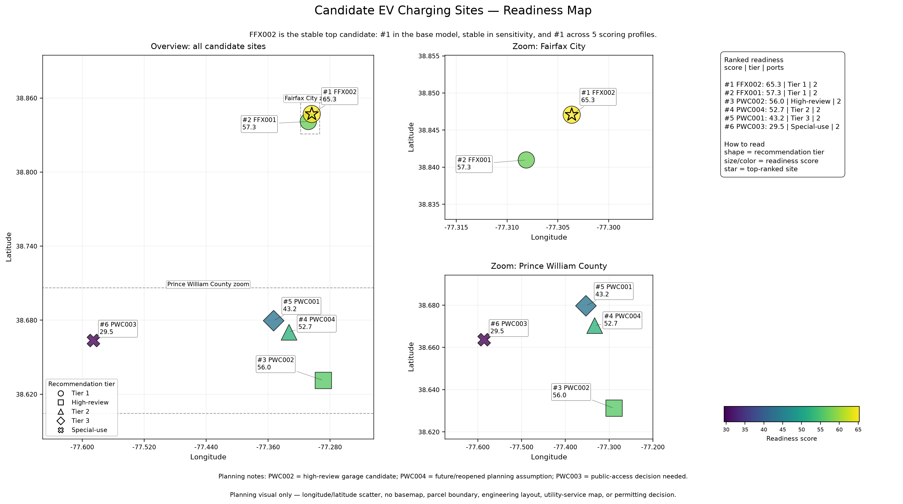
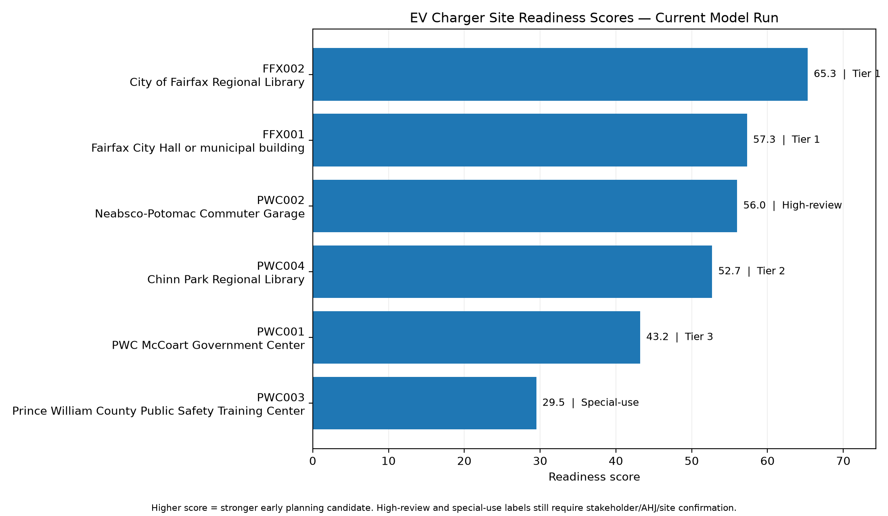
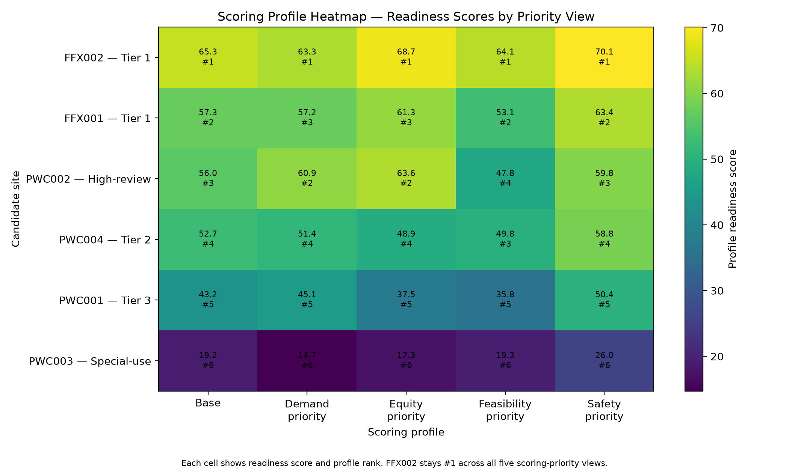

# EV Charger Site-Readiness and Right-Sizing Prototype


This repository contains a Python planning-support prototype for comparing public EV charging candidate sites in Fairfax City and Prince William County.

The model evaluates sites using demand, implementation feasibility, site review, equity, data confidence, and charger right-sizing signals. It supports early planning only; it is not a construction, procurement, or approval tool.

## Branch note

This branch is currently used for V2 expansion-planning work.

- Use `main` for the stable V1 baseline workflow.
- Use `v2-expansion-planning` for expanded V2 candidate testing, public-data upgrades, and V2-specific generated outputs.
- V2 generated outputs are local files under `data/outputs/` and are ignored by Git unless a polished summary is intentionally copied into `docs/`.

## Start here

- Shortest reproduction guide: [START_HERE.md](START_HERE.md)
- Step-by-step reproduction checklist: [REPRODUCIBILITY_CHECKLIST.md](REPRODUCIBILITY_CHECKLIST.md)
- Simple repo map: [docs/REPO_MAP.md](docs/REPO_MAP.md)
- V2 public-data upgrade workflow: [docs/V2_PUBLIC_DATA_UPGRADE_WORKFLOW.md](docs/V2_PUBLIC_DATA_UPGRADE_WORKFLOW.md)

## Python version

Use Python 3.10 or newer. Python 3.11 is the tested version used by the GitHub Actions workflow.

## Stable V1 quick run

From the repository root on `main`:

```bash
git switch main
git pull --rebase origin main
python src/run_all.py
python src/build_deliverable_package.py
git status --short
```

A successful V1 run should show:

```text
Sanity check: PASSED
Baseline comparison: COMPLETED
Missing files: 0
```

## V2 expansion quick run

From the repository root on `v2-expansion-planning`:

```bash
git switch v2-expansion-planning
git pull --rebase origin v2-expansion-planning
python src/run_v2.py
git status --short
```

The V2 runner writes V2-specific outputs such as:

```text
data/outputs/v2_site_results.csv
data/outputs/v2_action_matrix.md
data/outputs/v2_data_quality_report.csv
data/outputs/v2_sensitivity_summary.csv
data/outputs/v2_profile_results.csv
data/outputs/v2_profile_comparison.md
data/outputs/v2_results_interpretation.md
data/outputs/charts/v2_readiness_score_chart.png
```

## Optional V2 public-data upgrade setup

The base model dependencies stay lightweight in [requirements.txt](requirements.txt). Public-data upgrade scripts that process raw TIGER/ACS/LODES/VDOT exports may need the optional V2 requirements:

```bash
python -m pip install -r requirements-v2.txt
```

## Visual snapshot

The readiness map gives the fastest visual overview of the candidate sites, their relative locations, and their ranked readiness result.



The readiness score chart shows the current ranking directly.



The profile heatmap shows whether the same sites stay strong when different planning priorities are emphasized.



## Main outputs to review

### V1 generated outputs

- [data/outputs/model_run_summary.md](data/outputs/model_run_summary.md)
- [data/outputs/results_interpretation.md](data/outputs/results_interpretation.md)
- [data/outputs/action_matrix.md](data/outputs/action_matrix.md)
- [Readiness score visual](docs/assets/charts/readiness_score_chart.png)
- [Data confidence visual](docs/assets/charts/data_confidence_chart.png)
- [Profile rank stability visual](docs/assets/charts/profile_rank_stability_chart.png)
- [Profile score heatmap visual](docs/assets/charts/profile_score_heatmap.png)
- [Site readiness map visual](docs/assets/charts/site_readiness_map.png)

### V2 generated outputs

- `data/outputs/v2_site_results.csv`
- `data/outputs/v2_action_matrix.md`
- `data/outputs/v2_results_interpretation.md`
- `data/outputs/v2_profile_comparison.md`
- `data/outputs/charts/v2_readiness_score_chart.png`

## Main input and output files

| File | Purpose |
|---|---|
| [data/inputs/real_sites_v1.csv](data/inputs/real_sites_v1.csv) | Stable V1 candidate-site input dataset. |
| [data/inputs/real_sites_v2.csv](data/inputs/real_sites_v2.csv) | Active V2 expansion candidate-site input dataset. |
| [data/outputs/site_results.csv](data/outputs/site_results.csv) | Main V1 model result table. |
| `data/outputs/v2_site_results.csv` | Main V2 model result table generated locally. |
| [data/outputs/deliverable_package/](data/outputs/deliverable_package/) | Shareable local V1 package after generation. |

## Main workflow scripts

| File | Purpose |
|---|---|
| [src/run_all.py](src/run_all.py) | Run the stable V1 workflow. |
| [src/run_v2.py](src/run_v2.py) | Run the V2 expansion workflow with V2-specific output paths. |
| [src/ev_charger_model.py](src/ev_charger_model.py) | Main scoring and right-sizing model. |
| [src/add_action_matrix.py](src/add_action_matrix.py) | Adds next-action labels. |
| [src/check_outputs.py](src/check_outputs.py) | Checks V1 generated outputs. |
| [src/build_deliverable_package.py](src/build_deliverable_package.py) | Builds the shareable V1 package. |
| [src/build_v2_public_data_upgrades.py](src/build_v2_public_data_upgrades.py) | Builds reviewable public-data upgrade extracts for selected V2 sites. |

See [docs/REPO_MAP.md](docs/REPO_MAP.md) for the full script and file map.

## Core result fields

```text
readiness_score = how promising the site looks

data_confidence_score = how complete the current input data is

action_label = what to do next
```

## Current planning interpretation

Stable V1 baseline:

```text
FFX002 — stable top candidate
FFX001 — stable second candidate
PWC002 — high-review garage candidate
PWC004 — promising with future/reopened timeline caveat
PWC001 — lower-priority monitor candidate
PWC003 — special-use / not general-public priority under current assumptions
```

Current V2 expansion run after the first reviewed public-data upgrade batch:

```text
FFX002 — current top candidate
FFX004 — current second-ranked Tier 1 candidate after V2 public-data upgrades
FFX001 — promising but lower-confidence Tier 2 candidate
PWC002 — high-review garage candidate
PWC004 — promising with future/reopened timeline caveat
FFX003 — promising Tier 2 candidate needing further assumption refinement
PWC001 — lower-priority monitor candidate
PWC003 — special-use / not general-public priority under current assumptions
```

## Documentation

- [START_HERE.md](START_HERE.md)
- [REPRODUCIBILITY_CHECKLIST.md](REPRODUCIBILITY_CHECKLIST.md)
- [docs/REPO_MAP.md](docs/REPO_MAP.md)
- [docs/DATA_DICTIONARY.md](docs/DATA_DICTIONARY.md)
- [docs/DATA_SOURCES.md](docs/DATA_SOURCES.md)
- [docs/METHODOLOGY.md](docs/METHODOLOGY.md)
- [docs/PROJECT_STATUS.md](docs/PROJECT_STATUS.md)
- [docs/V2_PUBLIC_DATA_UPGRADE_WORKFLOW.md](docs/V2_PUBLIC_DATA_UPGRADE_WORKFLOW.md)

The longer documentation and presentation files remain in [docs/](docs/).

## Important limitation

The prototype is useful for transparent early planning, but any real project decision must be checked with the appropriate site owner, technical reviewers, permitting offices, and procurement process.
