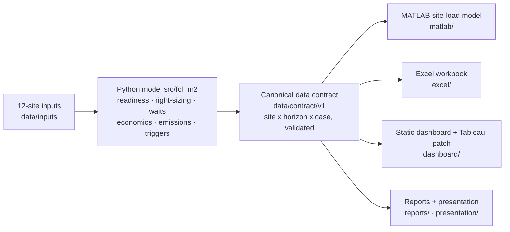

# Future City Fellowship — Safe, Code-Responsive EV Charging Planning

Decision-support platform for planning safe, code-responsive public EV charging in
**Fairfax City** and **Prince William County**, Virginia.


-B08948)


## What this project is

Electrification in Northern Virginia is expanding faster than local readiness — code
interpretation, responder training, siting practice, and emergency-access planning.
This repository is a **planning-support prototype** built by a George Mason University
Future City Fellowship team that screens 12 real public candidate sites, right-sizes
charger deployments, and models outcomes at 10/20/30-year horizons (2036 / 2046 / 2056
from a 2026 baseline).

**The leading strategy it supports:** *staged, evidence-gated deployment* — start with
25 charging ports at the strongest sites, pre-build expandable civil/electrical pathways
for up to 48, and energize more only when observed utilization, wait, and reliability
data clear predefined, equity-aware triggers. This is the direct answer to the client's
own operating history (a 70-port garage installation that ended with 17 stations
decommissioned, and a trenching-driven cost overrun).

> **What this is not.** This is not engineering approval, a permit or code determination,
> a utility capacity confirmation, an official forecast, or a budget. Site *readiness*
> is not construction *approval*: **0 of 12 sites have High data confidence, and
> electrical capacity is a labeled placeholder at all 12 sites** pending utility and
> facility verification.

## Headline results (canonical contract v1.0.0, screening values)

| Horizon | Active ports (base → high path) | Staged plan NPC | Broad buildout NPC | Staged avoids | Net CO2e avoided |
|---|---|---|---|---|---|
| 2026 | 25 | — | — | — | ≈43 t/yr |
| 2036 | 35 → 44 | $1.56M | $1.87M | **$0.31M** | ≈82–113 t/yr |
| 2046 | 44 → 48 | $2.29M | $2.64M | **$0.34M** | ≈130–195 t/yr |
| 2056 | 44 → 48 (48-port pathway ceiling) | $3.01M | $3.41M | **$0.39M** | ≈173–260 t/yr |

Costs are screening-class net present cost (3% real, base escalation) — never budgets.
Emissions use the EPA eGRID2023 Rev 2 SRVC factor (596.3 lb CO2e/MWh, refreshed
annually) with labeled displacement assumptions.

Top-ranked site under the canonical `milestone2_v3` mode: **FFX004 (53.4)**, with
**FFX002 — City of Fairfax Regional Library** second at **51.8**. FFX002 ranks first under
`legacy_v2` at 58.8; the two modes are not interchangeable, so the mode is always named.
Data confidence is **Low at all 12 sites** — no site reaches Medium, let alone High.

## How the system fits together



Python is the single producer; MATLAB, Excel, Tableau, and every visual consume the
same validated contract, so no two artifacts can disagree about a port count, a year,
or whether capacity is a placeholder (`capacity_basis` travels with every row).

## Two model modes

| Mode | Purpose |
|---|---|
| `legacy_v2` | Bit-exact reproduction of the accepted V2 baseline (golden-tested: FFX002 58.8; 25 starter / 48 pathway ports) |
| `milestone2_v3` | Canonical 2036/2046/2056 horizons, cohort-independent fixed-anchor scoring, typed data confidence, peak-window + discrete-event waits, lifecycle economics, emissions, equity-aware expansion triggers |

V3 never silently replaces legacy numbers — see the
[migration guide](docs/migration-from-v2.md).

## Quick start

```bash
make setup          # venv + editable install with pinned test extras
make test           # 80 tests incl. legacy golden tests (coverage gate 80%)
make run-legacy     # reproduce the accepted V2 baseline (25/48)
make run-v3         # full V3 run: scores, scenarios, economics, emissions, contract
make validate       # validate the tracked canonical contract
./scripts/verify.sh # every repository verification gate
```

Requirements: Python 3.11+ (verified on 3.12/3.14). MATLAB R2025b for the `matlab/`
model (**not required** for anything above — and note that the MATLAB code has been
statically checked but never executed; see
[matlab/EXECUTION_STATUS.md](matlab/EXECUTION_STATUS.md)).

## Repository map

| Path | Contents |
|---|---|
| [`src/fcf_m2/`](src/README.md) | The Python model (scoring, right-sizing, waits, economics, emissions, confidence, triggers, contract) |
| [`data/`](data/README.md) | Site inputs, scoring anchors, provenance, cached GIS boundaries, the canonical contract |
| [`tests/`](tests/README.md) | 80-test suite incl. golden legacy fixtures and contract validation |
| [`matlab/`](matlab/README.md) | Site-grid load-behavior model (session-based profiles, capacity guard, managed charging) |
| [`excel/`](excel/README.md) | Updated grid-planning workbook with live reconciliation checks |
| [`dashboard/`](dashboard/README.md) | Offline static dashboard (9 visuals) + Tableau patch package |
| [`reports/`](reports/README.md) | Final Milestone 2 report, gap-closure status, risk register, briefs |
| [`presentation/`](presentation/README.md) | Final deck, speaker notes, timing runbook, Q&A backup |
| [`docs/`](docs/README.md) | Architecture, methodology, standards, operations, human-action packages |
| [`scripts/`](scripts/README.md) | Verification harness and artifact builders |

## Key documents

- **[Final Milestone 2 report](reports/milestone-2/Future_City_Fellowship_Milestone_2_Final_Report.md)** — the integrated project record
- **[Presentation deck (PDF)](presentation/deck/Future_City_Fellowship_Milestone_2_Final.pdf)** + [speaker notes](presentation/deck/Future_City_Fellowship_Milestone_2_Speaker_Notes.md)
- **[Gap-closure status](reports/milestone-2/Milestone_2_Gap_Closure_Status.md)** — all 52 fellowship criteria dispositioned
- **[Standards application matrix](docs/standards/FINAL_STANDARDS_APPLICATION_MATRIX.md)** — UL 2594 + UL 3600 highlighted; adopted-vs-latest editions
- **[Proposed standard concept](docs/standards/PROPOSED_MUNICIPAL_EV_STANDARD_CONCEPT.md)** — fellowship design exercise, not a UL/ULSE proposal
- **[Reproduction guide](docs/operations/reproduction-guide.md)** · **[Migration from V2](docs/migration-from-v2.md)** · **[Contract v1 → v2](docs/migration-from-v3.md)** · **[Open human actions](docs/operations/open-human-actions.md)**

## Verification

`./scripts/verify.sh` runs all ten gates: the pytest suite with a coverage floor, legacy
baseline reproduction, contract rule/schema/hash-chain validation, cross-model
reconciliation against the MATLAB input, generated-docs drift, footer QA on every dashboard
visual, secret and local-path scans, size limits, and Markdown link checks. It exits with the
number of failures, so a red run is visible in the exit code, not just in the log.

CI runs **the same gates**, on every push and every pull request
([tests.yml](.github/workflows/tests.yml)) — literally the same, because CI invokes
`verify.sh` rather than keeping a second list of steps in step with the first. There is one
definition of what "green" means. Both the secret scan and the Markdown link check are shared
modules (`scripts/secret_scan.py`, `scripts/check_internal_links.py`) for the same reason.

## Standards and safety boundary

Design intent is governed by **UL 2594** (EVSE safety) and **UL 3600** (circular-economy
measurement), with UL 2231, **NEC Article 625 as adopted in Virginia (2020 NEC via the
2021 USBC)**, the Virginia SFPC, and US Access Board EVSE guidance (rule at NPRM stage
as of July 2026) as essential supporting requirements. Storage and DC-fast-charging
standards are explicitly out of scope (no BESS or DCFC in the plan). All permit,
disconnect-placement, access, and code-edition determinations rest with the local AHJ.

## Known limitations

1. Electrical capacity is a placeholder at 12/12 sites (`capacity_basis = placeholder`).
2. Demand is synthetic and uncalibrated; growth multipliers are provisional conventions.
3. Costs are screening-class benchmarks; emissions rest on labeled assumptions.
4. MATLAB code is statically checked only — no execution has occurred (no license was available).
5. The Tableau `.twbx` was not rebuilt/verified — the static dashboard is the guaranteed artifact; a complete [patch package](dashboard/tableau/TABLEAU_IMPLEMENTATION_BLOCKER.md) exists for a Tableau Desktop operator.
6. Client, team-adoption, AHJ, utility, and funding steps remain open — see [open human actions](docs/operations/open-human-actions.md).

## Project status

Milestone 2 package complete (July 2026); presentation 2026-07-21. Next phase: client
follow-up, utility/facility data requests (which upgrade `capacity_basis` from
placeholder), AHJ conversations, and pilot preparation.

## Team

Anna · Laylas · Andy · Adama · Paula — George Mason University Future City Fellowship,
in consultation with Prince William County's Office of Sustainability and Fire &
Rescue interviewees.

*License: not yet selected — all rights reserved by the team until a license is chosen.*
