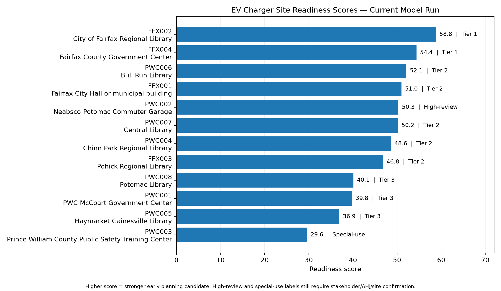
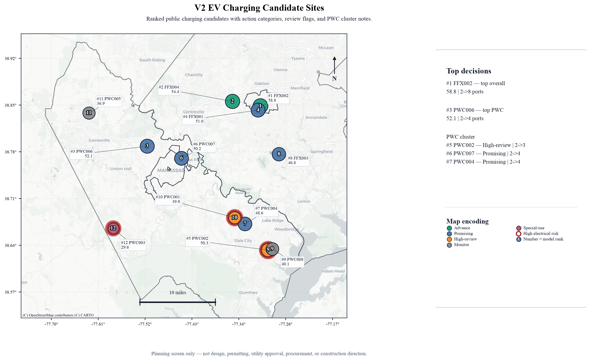
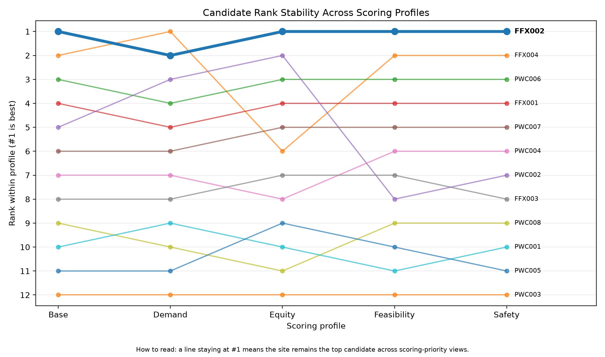
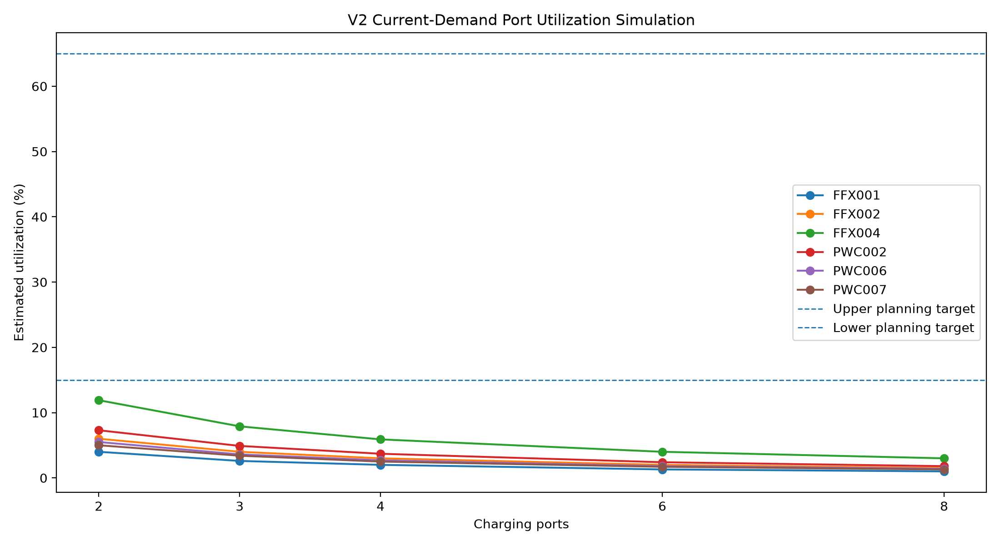

# EV Charger Site-Readiness and Right-Sizing Prototype

[V2 model workflow](.github/workflows/v2-model-check.yml) · [Repository link check](.github/workflows/link-check.yml)

This repository contains a Python planning-support prototype for comparing public EV charging candidate sites in Fairfax City and Prince William County.

The model evaluates sites using demand, implementation feasibility, site review, equity, data confidence, electrical-risk screening, right-sizing, port-use simulation, port-sizing scenario analysis, and action recommendations.

## Current active branch

```text
v2-expansion-planning
```

Use:

```text
main = stable V1 baseline workflow
v2-expansion-planning = active V2 prototype workflow
```

## Start here

- [START_HERE.md](START_HERE.md) — shortest project entry point
- [docs/ACTIVE_DOCS_INDEX.md](docs/ACTIVE_DOCS_INDEX.md) — clean index of active reviewer-facing docs
- [docs/REVIEWER_GUIDE.md](docs/REVIEWER_GUIDE.md) — review path for someone inspecting the repo
- [REPRODUCIBILITY_CHECKLIST.md](REPRODUCIBILITY_CHECKLIST.md) — step-by-step local reproduction checklist
- [docs/V2_CURRENT_WORKFLOW_GUIDE.md](docs/V2_CURRENT_WORKFLOW_GUIDE.md) — active V2 workflow guide
- [docs/REPO_MAP.md](docs/REPO_MAP.md) — folder and file map
- [src/README.md](src/README.md) — script-by-script index
- [docs/MAINTENANCE_CHECKLIST.md](docs/MAINTENANCE_CHECKLIST.md) — checks to run before pushing or sharing
- [docs/PROJECT_STATUS.md](docs/PROJECT_STATUS.md) — current project state
- [docs/checkpoints/README.md](docs/checkpoints/README.md) — checkpoint and history index

## Python version

Use Python 3.10 or newer. Python 3.11 is the tested version used by the GitHub Actions workflow.

## V2 quick run

From the repository root on `v2-expansion-planning`:

```bash
git switch v2-expansion-planning
git pull --rebase origin v2-expansion-planning
make setup
make run-v2
make check-v2
```

Equivalent raw Python commands:

```bash
pip install -r requirements.txt
pip install -r requirements-gis.txt
python src/run_v2.py
python src/check_outputs_v2.py
```

A successful V2 run should end with:

```text
Status: PASSED
Copied files: 35/35
Synced files: 35/35
```

## Useful maintenance commands

```bash
make help        # show available project commands
make links       # check Markdown links
make health      # run V2 output check and Markdown link check
make clean-local # remove local generated caches
make status      # show git status
```

## Stable V1 quick run

From the repository root on `main`:

```bash
git switch main
git pull --rebase origin main
python src/run_all.py
python src/build_deliverable_package.py
git status --short
```

## Current V2 workflow

`src/run_v2.py` runs the full active 24-step workflow:

```text
site-readiness model
action matrix
data validation
sensitivity analysis
scoring-profile analysis
charts and readiness map
electrical-risk scenario analysis
right-sizing scenario analysis
port-use simulation
port-sizing scenario analysis
right-sizing validation
executive site summary
GIS decision maps for report and README use
interpretation report
run summary
baseline comparison
workflow manifest
deliverable package
```

## Main V2 outputs to review

Start with the V2 deliverable package:

```text
data/outputs/deliverable_package_v2/README.md
data/outputs/deliverable_package_v2/reports/v2_executive_site_summary.md
data/outputs/deliverable_package_v2/tables/v2_executive_site_summary.csv
data/outputs/deliverable_package_v2/charts/v2_site_decision_map.png
data/outputs/deliverable_package_v2/charts/v2_site_decision_map_readme.png
data/outputs/deliverable_package_v2/reports/v2_right_sizing_validation_report.md
data/outputs/deliverable_package_v2/reports/v2_port_sizing_scenario_report.md
data/outputs/deliverable_package_v2/tables/v2_port_sizing_scenario_summary.csv
data/outputs/deliverable_package_v2/charts/v2_port_sizing_scenario_heatmap.png
data/outputs/deliverable_package_v2/reports/v2_run_summary.md
```

Important direct outputs:

```text
data/outputs/v2_site_results.csv
data/outputs/v2_right_sizing_scenarios.csv
data/outputs/v2_port_utilization_simulation.csv
data/outputs/v2_port_sizing_scenario_results.csv
data/outputs/v2_port_sizing_scenario_summary.csv
data/outputs/v2_right_sizing_validation.csv
data/outputs/v2_executive_site_summary.csv
data/outputs/v2_baseline_comparison.md
data/outputs/v2_workflow_success.json
```

Important V2 charts generated locally:

```text
data/outputs/charts/v2_polished_readiness_score_chart.png
data/outputs/charts/v2_data_confidence_chart.png
data/outputs/charts/v2_profile_score_heatmap.png
data/outputs/charts/v2_profile_rank_stability_chart.png
data/outputs/charts/v2_site_readiness_map.png
data/outputs/charts/v2_site_decision_map.png
data/outputs/charts/v2_site_decision_map_readme.png
data/outputs/charts/v2_port_utilization_simulation.png
data/outputs/charts/v2_port_sizing_scenario_heatmap.png
```

## V2 preview visuals

### V2 readiness ranking



### V2 GIS decision map



### V2 rank stability across profiles



### V2 port-use simulation and right-sizing validation



## Main input and output files

| File | Purpose |
|---|---|
| [data/inputs/real_sites_v1.csv](data/inputs/real_sites_v1.csv) | Stable V1 candidate-site input dataset. |
| [data/inputs/real_sites_v2.csv](data/inputs/real_sites_v2.csv) | Active V2 candidate-site input dataset. |
| [data/inputs/v2_port_sizing_scenarios.csv](data/inputs/v2_port_sizing_scenarios.csv) | Active V2 port-sizing scenario assumptions. |
| `data/outputs/v2_executive_site_summary.csv` | Main V2 executive decision table generated locally. |
| `data/outputs/v2_port_sizing_scenario_summary.csv` | Scenario-level summary of port-sizing stress tests. |
| `data/outputs/deliverable_package_v2/` | Clean local V2 review package generated by the workflow. |

## Main workflow scripts

| File | Purpose |
|---|---|
| [src/run_v2.py](src/run_v2.py) | Run the active 24-step V2 workflow. |
| [src/check_outputs_v2.py](src/check_outputs_v2.py) | Check V2 outputs, site coverage, scenario layer, and package sync. |
| [src/build_v2_deliverable_package.py](src/build_v2_deliverable_package.py) | Build the clean V2 deliverable package. |
| [src/run_port_utilization_simulation.py](src/run_port_utilization_simulation.py) | Run the V2 port-use simulation. |
| [src/run_port_sizing_scenario_analysis.py](src/run_port_sizing_scenario_analysis.py) | Stress-test port sizing under alternate assumptions. |
| [src/validate_right_sizing_with_simulation.py](src/validate_right_sizing_with_simulation.py) | Compare right-sizing recommendations with simulation results. |
| [src/build_v2_executive_summary.py](src/build_v2_executive_summary.py) | Build the V2 executive decision table. |
| [src/run_all.py](src/run_all.py) | Run the stable V1 workflow. |
| [src/ev_charger_model.py](src/ev_charger_model.py) | Main scoring and right-sizing model. |

See [src/README.md](src/README.md) for the script-by-script index and [docs/REPO_MAP.md](docs/REPO_MAP.md) for the fuller repository map.

## Current planning interpretation

```text
FFX002 is the strongest current candidate.
FFX004 is the second-ranked Tier 1 candidate.
PWC006 is the strongest current Prince William County library candidate.
PWC002 remains useful but high-review.
PWC003 should remain special-use unless its use case changes.
```

Current V2 port-sizing scenario result:

```text
The future-ready capacity plan is stable across the first five tested scenarios.
Only the combined-stress scenario creates one-port gaps, affecting PWC002 and PWC008.
```

- [START_HERE.md](START_HERE.md)
- [docs/ACTIVE_DOCS_INDEX.md](docs/ACTIVE_DOCS_INDEX.md)
- [docs/REVIEWER_GUIDE.md](docs/REVIEWER_GUIDE.md)
- [REPRODUCIBILITY_CHECKLIST.md](REPRODUCIBILITY_CHECKLIST.md)
- [docs/V2_CURRENT_WORKFLOW_GUIDE.md](docs/V2_CURRENT_WORKFLOW_GUIDE.md)
- [docs/REPO_MAP.md](docs/REPO_MAP.md)
- [src/README.md](src/README.md)
- [docs/MAINTENANCE_CHECKLIST.md](docs/MAINTENANCE_CHECKLIST.md)
- [docs/checkpoints/README.md](docs/checkpoints/README.md)
- [docs/DATA_DICTIONARY.md](docs/DATA_DICTIONARY.md)
- [docs/DATA_SOURCES.md](docs/DATA_SOURCES.md)
- [docs/METHODOLOGY.md](docs/METHODOLOGY.md)
- [docs/PROJECT_STATUS.md](docs/PROJECT_STATUS.md)
- [docs/checkpoints/V2_PORT_SIZING_SCENARIO_ANALYSIS_CHECKPOINT.md](docs/checkpoints/V2_PORT_SIZING_SCENARIO_ANALYSIS_CHECKPOINT.md)

## Important limitation

The prototype is useful for transparent early planning, but any real project decision still requires confirmation by the proper reviewers and stakeholders.

<!-- TABLEAU_WORKBOOK_START -->
## Tableau visual artifact

The main public-facing visual artifact for this project is the packaged Tableau workbook:

`tableau/EV_Charging_Site_Readiness_Workbook.twbx`

The workbook expands the project beyond the earlier static/model-generated PNG charts. It includes readiness rankings, maps, port-growth planning, review burden analysis, profile score heat maps, rank-stability analysis, data-confidence review, port-sizing scenario gaps, utilization simulation, and an action decision quadrant.

Tableau-ready CSV inputs are generated by:

`python src/build_tableau_exports.py`

Generated Tableau CSVs are written to:

`data/outputs/tableau/`

These generated CSVs are ignored by Git by default. The committed source artifacts are the export script and the packaged Tableau workbook.

Planning-support only: the Tableau workbook is not final engineering, permitting, utility, procurement, fire, ADA, stormwater, or construction approval.
<!-- TABLEAU_WORKBOOK_END -->
