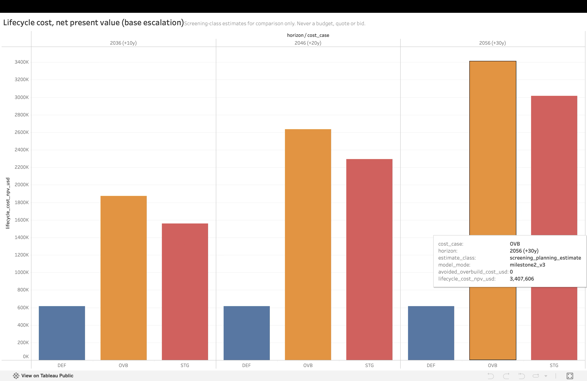
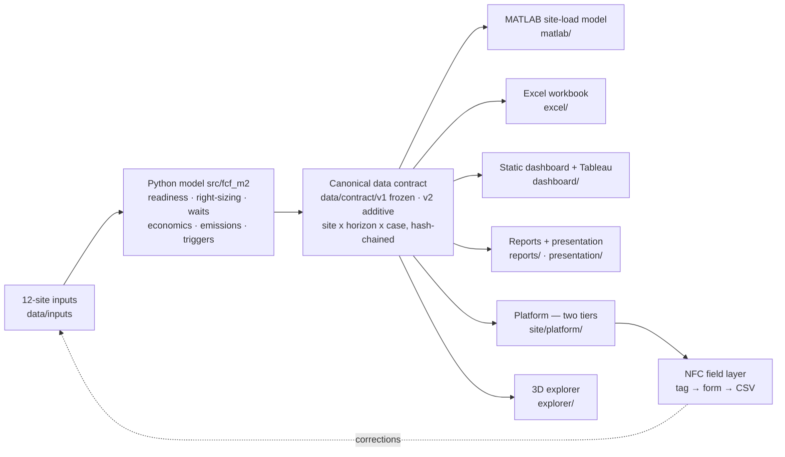

# Future City Fellowship — Safe, Code-Responsive EV Charging Planning

Decision-support platform for planning safe, code-responsive public EV charging in
**Fairfax City**, **Fairfax County** and **Prince William County**, Virginia.


-B08948)



## Start here

A commuter garage in Prince William County has 70 EV charging ports. Seventeen were later taken
offline — they cost roughly $1,000 per station per year to keep, and not enough people were
using them. At a different county site, a ten-port installation ran over budget because the
trenching turned out to be longer than anyone planned for.

Those two things pull in opposite directions. Build too much and you pay to run chargers
nobody uses. Build too little, and adding more later means digging up ground you already
paid to close.

**This project is about the middle.** Install fewer ports than you think you need, but put the
conduit and electrical pathway in for more while the ground is already open — then energise the
rest only when real usage data says to. For these twelve sites that means **25 ports now, a
pathway built for 48**.

That's the whole idea. Everything below is the evidence for it, and the honest accounting of
what we don't know.

> **The most important thing we don't know:** nobody has confirmed that any of these twelve
> sites has the electrical capacity to support chargers. Not one. That figure is a labelled
> placeholder everywhere, and the software **refuses** to make a feasibility claim from it.

**New here?** → **[Start here](docs/START_HERE.md)** — a five-minute orientation with a
reader map and an honest FAQ · [What this can and can't tell
you](docs/WHAT_THIS_CAN_AND_CANNOT_TELL_YOU.md) · [Glossary](docs/GLOSSARY.md)

## What this project is

Electrification in Northern Virginia is expanding faster than local readiness — code
interpretation, responder training, siting practice, and emergency-access planning.
This repository is a **planning-support prototype** built by a George Mason University
Future City Fellowship team that screens 12 real public candidate sites, right-sizes
charger deployments, and models outcomes at 10/20/30-year horizons (2036 / 2046 / 2056
from a 2026 baseline).

**The leading strategy it supports:** *staged, evidence-gated deployment* — start with
25 charging ports at the strongest sites, pre-build expandable civil/electrical pathways
for up to 48, and energize more only when observed utilization, wait, and reliability
data clear predefined, equity-aware triggers. This is the direct answer to the client's
own operating history described above: the Neabsco-Potomac garage (70 ports, 17 later
taken offline) and the McCoart trenching cost escalation.

> **What this is not.** This is not engineering approval, a permit or code determination,
> a utility capacity confirmation, an official forecast, or a budget. Site *readiness*
> is not construction *approval*: **all 12 sites score Low data confidence — none reaches
> even Medium — and electrical capacity is a labeled placeholder at all 12 sites** pending
> utility and facility verification.

## Headline results (canonical contract v1.0.0, screening values)

| Horizon | Active ports (base → high path) | Staged plan NPC | Broad buildout NPC | Staged avoids | Net CO2e avoided |
|---|---|---|---|---|---|
| 2026 | 25 | — | — | — | ≈43 t/yr |
| 2036 | 35 → 44 | $1.56M | $1.87M | **$0.31M** | ≈82–113 t/yr |
| 2046 | 44 → 48 | $2.29M | $2.64M | **$0.34M** | ≈130–195 t/yr |
| 2056 | 44 → 48 (48-port pathway ceiling) | $3.01M | $3.41M | **$0.39M** | ≈173–260 t/yr |

Costs are screening-class net present cost (3% real, base escalation) — never budgets.
Emissions use the EPA eGRID2023 Rev 2 SRVC factor (596.3 lb CO2e/MWh, refreshed
annually) with labeled displacement assumptions.

Top-ranked site under the canonical `milestone2_v3` mode: **FFX004 (53.4)**, with
**FFX002 — City of Fairfax Regional Library** second at **51.8**. FFX002 ranks first under
`legacy_v2` at 58.8; the two modes are not interchangeable, so **anything generated from the
contract names its mode**. Three artifacts predate that rule and still carry `legacy_v2` ranks:
the superseded public Tableau workbook (limitation 5 below, queued for removal); this project's
own `results.html` rotating gallery, which now states the mode on the page (FIND-NUM-03,
open action 8c); and the **dated Milestone 2 deck and speaker notes**, which name no mode at
all. The deck is deliberately left alone — it is a record of what was presented on 2026-07-21,
and editing a dated deliverable to match a later model would misrepresent what was said.
Data confidence is **Low at all 12 sites** — no site reaches Medium, let alone High.

## How the system fits together



Python is the single producer; MATLAB, Excel, Tableau, the platform, the 3D explorer and every
visual consume the same validated contract, so no two artifacts can disagree about a port
count, a year, or whether capacity is a placeholder (`capacity_basis` travels with every row).

The dotted arrow is the point of the whole design: a tapped NFC tag opens a form that feeds
observations back into the inputs, so the study can be corrected by someone standing at the site
rather than only by whoever holds the spreadsheet. The pages and forms are live; the **tags
themselves are not deployed** — placing anything on a public facility needs the facility
manager's consent, and that has not been sought.

## Two model modes

| Mode | Purpose |
|---|---|
| `legacy_v2` | Bit-exact reproduction of the accepted V2 baseline (golden-tested: FFX002 58.8; 25 starter / 48 pathway ports) |
| `milestone2_v3` | Canonical 2036/2046/2056 horizons, cohort-independent fixed-anchor scoring, typed data confidence, peak-window + discrete-event waits, lifecycle economics, emissions, equity-aware expansion triggers |

V3 never silently replaces legacy numbers — see the
[migration guide](docs/migration-from-v2.md).

## Quick start

```bash
make setup          # venv + editable install with pinned test extras
make test           # full suite incl. legacy golden tests (coverage gate 80%)
make run-legacy     # reproduce the accepted V2 baseline (25/48)
make run-v3         # full V3 run: scores, scenarios, economics, emissions, contract
make validate       # validate the tracked canonical contract
./scripts/verify.sh # every repository verification gate
```

Requirements: Python 3.11+ (verified on 3.12/3.14). MATLAB R2025b for the `matlab/`
model (**not required** for anything above). The MATLAB suite has been executed on licensed
MathWorks R2025b Update 5 — **49 passed / 0 failed** — but only against a *synthetic* fixture,
never against real site data; see
[matlab/EXECUTION_STATUS.md](matlab/EXECUTION_STATUS.md).

## Repository map

| Path | Contents |
|---|---|
| [`src/fcf_m2/`](src/README.md) | The Python model (scoring, right-sizing, waits, economics, emissions, confidence, triggers, contract) |
| [`data/`](data/README.md) | Site inputs, scoring anchors, provenance, cached GIS boundaries, the canonical contract |
| [`tests/`](tests/README.md) | The test suite incl. golden legacy fixtures and contract validation |
| [`matlab/`](matlab/README.md) | Site-grid load-behavior model (session-based profiles, capacity guard, managed charging) |
| [`excel/`](excel/README.md) | Updated grid-planning workbook with live reconciliation checks |
| [`dashboard/`](dashboard/README.md) | Offline static dashboard (9 visuals) + Tableau patch package |
| [`reports/`](reports/README.md) | Final Milestone 2 report, gap-closure status, risk register, briefs |
| [`presentation/`](presentation/README.md) | Final deck, speaker notes, timing runbook, Q&A backup |
| [`docs/`](docs/README.md) | Architecture, methodology, standards, operations, human-action packages |
| [`scripts/`](scripts/README.md) | Verification harness and artifact builders |
| `site/` | The deployed surfaces: the public website (`site/www/`) and the platform bundle (`site/platform/`) |
| `explorer/` | The 3D site explorer — Cesium viewer, 12 building models, its own ETL |
| `infra/` | The Lambda@Edge authoriser that gates `/platform/` behind Cognito sign-in |

## Key documents

- **[Final Milestone 2 report](reports/milestone-2/Future_City_Fellowship_Milestone_2_Final_Report.md)** — the integrated project record
- **[Presentation deck (PDF)](presentation/deck/Future_City_Fellowship_Milestone_2_Final.pdf)** + [speaker notes](presentation/deck/Future_City_Fellowship_Milestone_2_Speaker_Notes.md)
- **[Gap-closure status](reports/milestone-2/Milestone_2_Gap_Closure_Status.md)** — all 52 fellowship criteria dispositioned
- **[Standards application matrix](docs/standards/FINAL_STANDARDS_APPLICATION_MATRIX.md)** — UL 2594 + UL 3600 highlighted; adopted-vs-latest editions
- **[Proposed standard concept](docs/standards/PROPOSED_MUNICIPAL_EV_STANDARD_CONCEPT.md)** — fellowship design exercise, not a UL/ULSE proposal
- **[Reproduction guide](docs/operations/reproduction-guide.md)** · **[Migration from V2](docs/migration-from-v2.md)** · **[Contract v1 → v2](docs/migration-from-v3.md)** · **[Open human actions](docs/operations/open-human-actions.md)**

## Verification

`./scripts/verify.sh` runs all **39** gates: the pytest suite with a coverage floor, legacy
baseline reproduction, contract rule/schema/hash-chain validation, cross-model reconciliation
against the MATLAB input, generated-docs drift, footer QA on every dashboard visual, secret and
local-path scans, size limits, Markdown link checks, the 3D explorer and its CDN pins, the
Tableau workbook and embed forms, the platform's two tiers and their provenance, field-entry
parity in a real browser, the Cognito edge gate, supply-chain digests, packaging constraints,
intake degradation, and a clone-safety check that catches files present here but missing from a
fresh clone. It exits with the number of failures, so a red run is visible in the exit code, not
just in the log.

CI runs **the same gates**, on every push and every pull request
([tests.yml](.github/workflows/tests.yml)) — literally the same, because CI invokes
`verify.sh` rather than keeping a second list of steps in step with the first. There is one
definition of what "green" means. Both the secret scan and the Markdown link check are shared
modules (`scripts/secret_scan.py`, `scripts/check_internal_links.py`) for the same reason.

## Standards and safety boundary

Design intent is governed by **UL 2594** (EVSE safety) and **UL 3600** (circular-economy
measurement), with UL 2231, **NEC Article 625 as adopted in Virginia (2020 NEC via the
2021 USBC)**, the Virginia SFPC, and US Access Board EVSE guidance (rule at NPRM stage
as of July 2026) as essential supporting requirements. Storage and DC-fast-charging
standards are explicitly out of scope (no BESS or DCFC in the plan). All permit,
disconnect-placement, access, and code-edition determinations rest with the local AHJ.

## Known limitations

1. Electrical capacity is a placeholder at 12/12 sites (`capacity_basis = placeholder`).
2. Demand is synthetic and uncalibrated; growth multipliers are provisional conventions.
3. Costs are screening-class benchmarks; emissions rest on labeled assumptions.
4. MATLAB code **now runs on real MathWorks MATLAB** (R2025b Update 5, 49 tests passed / 0 failed, [`matlab/EXECUTION_STATUS.md`](matlab/EXECUTION_STATUS.md)) — but only against a **synthetic** fixture, because the public CI harness must never carry project data. The managed-charging numerics therefore remain unexercised against real capacity, since limitation 1 means no real capacity exists. The Simulink model is now **built** ([run 30296650057](matlab/outputs/run-30296650057/)) but has never been **simulated**, and no number here derives from it.
5. The Tableau workbook **has** been rebuilt, verified and [published](https://public.tableau.com/app/profile/yiguedan.philippe.andy.yaro/viz/EV_Charging_Site_Readiness_M2_Canonical/Milestone2Overview) from the canonical contract. **Four presentation features remain unbuildable** and are named in [CAPABILITY_GAP.md](dashboard/tableau/CAPABILITY_GAP.md): bar-in-bar, two reference lines, dashboard filter scoping, and the 8-point story. Separately, an **older workbook is still live on the same profile carrying superseded numbers** — see [open human actions](docs/operations/open-human-actions.md).
6. Client, team-adoption, AHJ, utility, and funding steps remain open — see [open human actions](docs/operations/open-human-actions.md).

## Project status

Milestone 2 package complete (July 2026); presentation 2026-07-21.

Since then the project has become a running system rather than a document set: the model is
served through a **platform** with two capability tiers, deployed at
`futurecityfellowship.andyyaro.com` with `/platform/` behind Cognito sign-in; a **3D explorer**
and a **static dashboard** read the same contract; an **NFC field layer** is built and walked
end to end on real hardware, so that someone standing in a car park could send a correction back
into the model — **no tag has been placed at any site, and no permission to place one has been
sought**; and an **intake layer** lets another jurisdiction bring its own data file without that
file quietly scoring better than it should.

None of this changes the epistemics. Capacity is still a placeholder at all twelve sites, and
the next real step is unchanged: client follow-up, utility and facility data requests (which
upgrade `capacity_basis` from placeholder), AHJ conversations, and pilot preparation.

## Team

Anna · Laylas · Andy · Adama · Paula — George Mason University Future City Fellowship,
in consultation with Prince William County's Office of Sustainability and Fire &
Rescue interviewees.

*License: not yet selected — all rights reserved by the team until a license is chosen.*
