<p align="center">
  <a href="https://futurecity.andyyaro.com">
    <picture>
      <source media="(prefers-color-scheme: dark)" srcset="docs/assets/brand/evsient-logo-endorsed-reversed.svg">
      
    </picture>
  </a>
</p>

<p align="center">
  <a href="https://github.com/andyyaro/EV-SIENT/actions/workflows/tests.yml"></a>
  <a href="LICENSE"></a>
  
  <a href="https://app.futurecity.andyyaro.com"></a>
  <a href="data/contract/v3/"></a>
  <a href="matlab/EXECUTION_STATUS.md"></a>
  <a href="docs/accessibility/ACR.md"></a>
</p>

<p align="center"><b>Every city wants more EV chargers. Few can show where the first ones should go, and why.</b></p>

<p align="center">
  <a href="https://futurecity.andyyaro.com">Study</a> |
  <a href="https://app.futurecity.andyyaro.com">Planner</a> |
  <a href="https://futurecity.andyyaro.com/film.html">Film</a> |
  <a href="#quick-start">Quickstart</a> |
  <a href="https://futurecity.andyyaro.com/method.html">Method</a> |
  <a href="docs/START_HERE.md">Docs</a> |
  <a href="docs/operations/v4-program/DECISIONS.md">Decisions</a>
</p>

<p align="center">
  <a href="https://futurecity.andyyaro.com/film.html"></a>
</p>

<p align="center"><b>Watch the 59-second launch film:</b> <a href="https://futurecity.andyyaro.com/film.html">with sound and captions</a> · <a href="https://futurecity.andyyaro.com/film/ev-sient-launch.mp4">MP4, 45 MB</a> · <a href="media/launch-film/">how it was made</a></p>

**EV-SIENT** (Site Evaluation & Navigation Tool) is a decision-support platform for planning safe,
code-responsive public EV charging in **Fairfax City**, **Fairfax County** and **Prince William
County**, Virginia, and a planner that runs the same model on anyone's own sites.

| | Live at | What it is |
|---|---|---|
| **The study** | [futurecity.andyyaro.com](https://futurecity.andyyaro.com) | The twelve-site screening: ranks, the four weighted parts behind each score, how stable each rank is, port plans to 2056 |
| **The planner** | [app.futurecity.andyyaro.com](https://app.futurecity.andyyaro.com) | Bring a spreadsheet of your own sites; the unmodified model runs in your browser and your file never leaves your device |

## See it

### The study: [futurecity.andyyaro.com](https://futurecity.andyyaro.com)

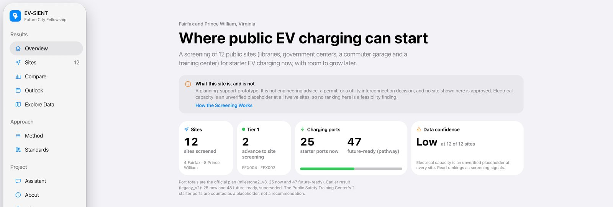

<table>
<tr>
<td width="50%">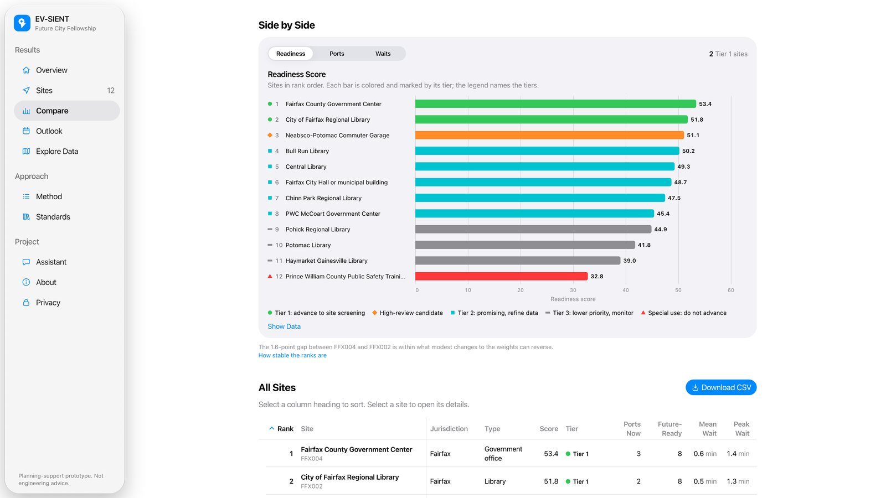</td>
<td width="50%">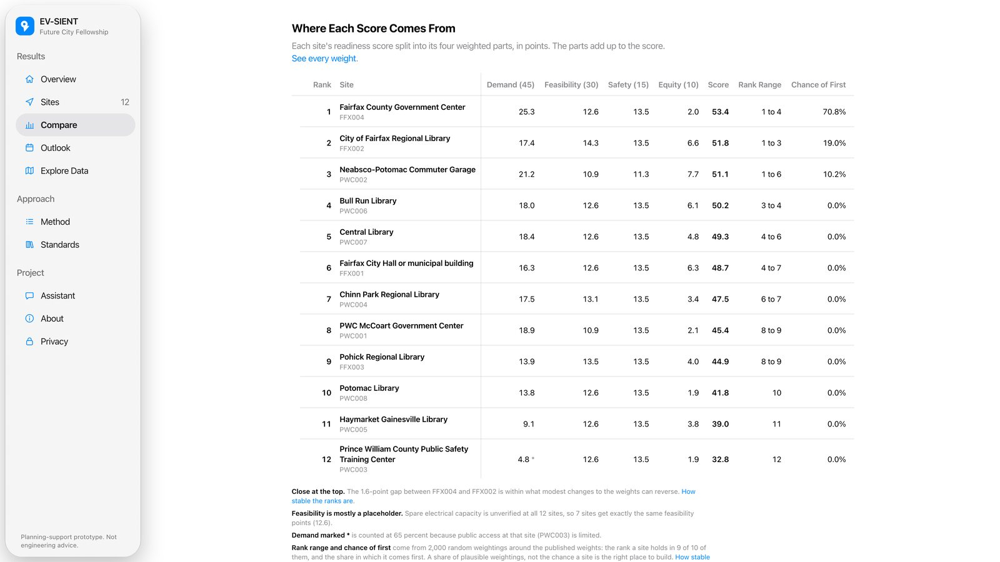</td>
</tr>
<tr>
<td>Every site's readiness score, coloured by decision tier.</td>
<td>Each score split into its four weighted parts, and how sure each rank is after 2,000 reweightings.</td>
</tr>
</table>

### The planner: [app.futurecity.andyyaro.com](https://app.futurecity.andyyaro.com)

<table>
<tr>
<td width="50%">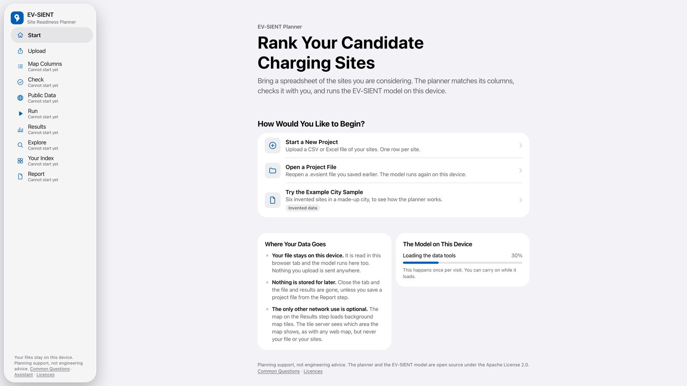</td>
<td width="50%">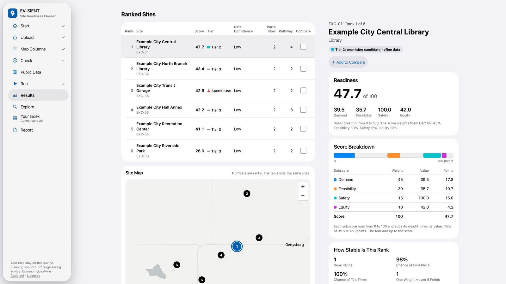</td>
</tr>
<tr>
<td>Start a project, reopen one, or try the invented Example City sample.</td>
<td>Ranked sites, a map, each site's score breakdown and how stable its rank is.</td>
</tr>
<tr>
<td>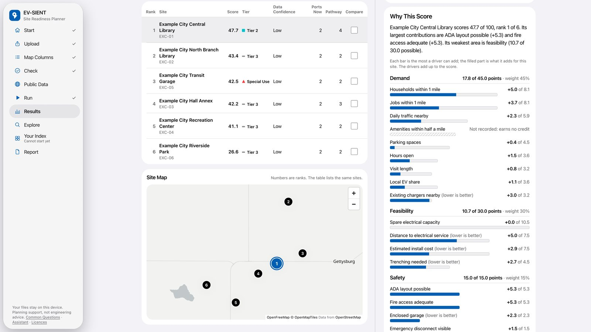</td>
<td>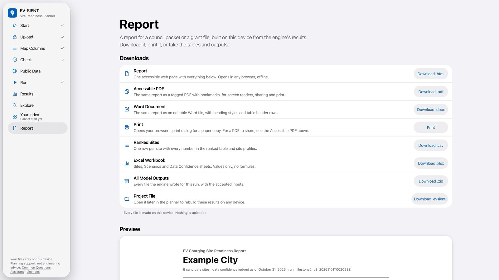</td>
</tr>
<tr>
<td>Why each site scores what it does, driver by driver.</td>
<td>A council-ready report (web page, tagged PDF, Word), the tables and a project file, all made on the device.</td>
</tr>
</table>

The six steps are Upload, Map Columns, Check, Public Data, Run and Results, then Explore, Your
Index and Report. Public Data can fill gaps from a public data hub that covers six states
(DEC-028). Columns the model does not use are carried and shown, never scored (DEC-026); Explore
describes them and Your Index lets a planner rank by them, labelled as their own
([flexible analysis](docs/FLEXIBLE_ANALYSIS.md)). An optional assistant sees the question and the step the
planner is on, plus only the summaries the planner agrees to share, never rows; it runs under a
hard $5 monthly cap. The planner installs and works offline.
Screens above use Example City, an invented sample. [More on the planner](platform/README.md).

### The analysis

<table>
<tr>
<td width="50%">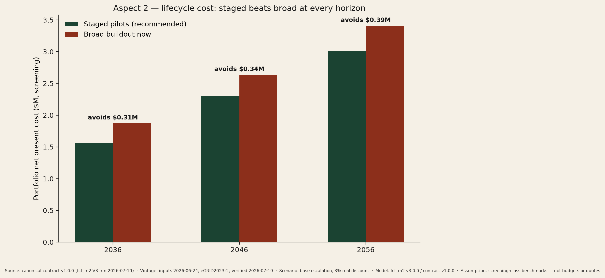</td>
<td width="50%">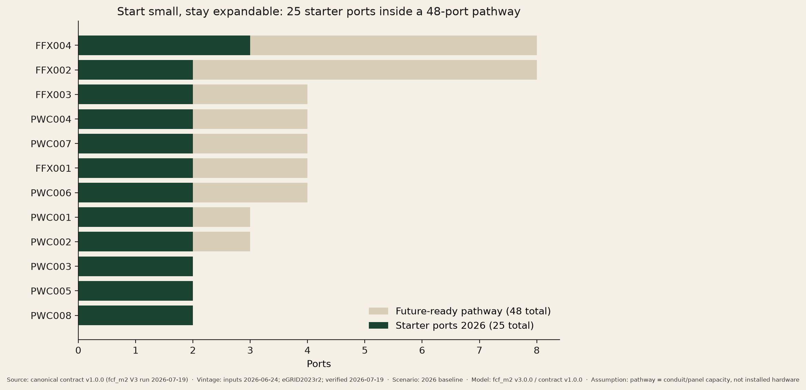</td>
</tr>
<tr>
<td>Staged pilots cost less than building out now, at every horizon.</td>
<td>25 starter ports inside a 47-port future-ready pathway.</td>
</tr>
<tr>
<td>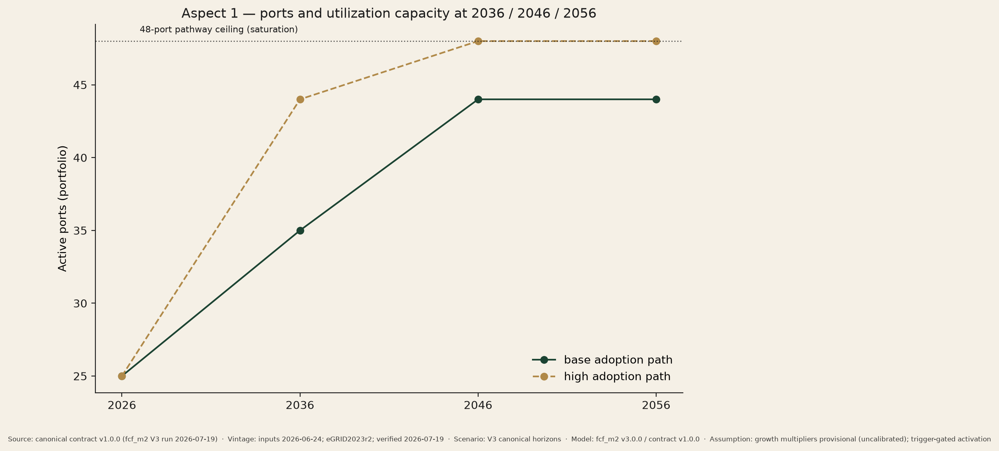</td>
<td>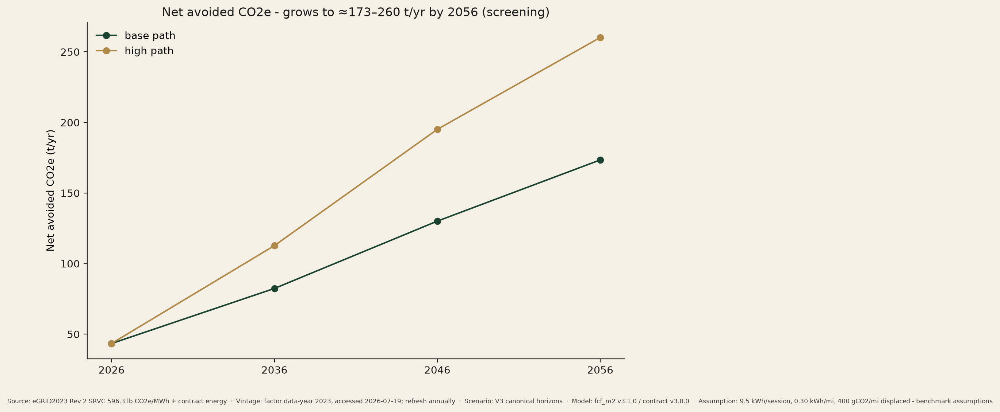</td>
</tr>
<tr>
<td>Active ports as adoption grows, up to the pathway ceiling.</td>
<td>Net avoided CO2e, base and high adoption paths.</td>
</tr>
</table>

Portfolio net present cost, base escalation, 3% real discount, from the authoritative contract v3
(DEC-027): staged **$1.49M vs $1.85M** for a broad buildout by 2036, **$2.21M vs $2.60M** by 2046,
**$2.92M vs $3.36M** by 2056. Screening-class estimates for comparing cases against each other,
never a budget, quote or bid. All nine charts are in [`dashboard/static/`](dashboard/static/).

## Start here

A commuter garage in Prince William County has 70 EV charging ports. Seventeen were later taken
offline - they cost roughly $1,000 per station per year to keep, and not enough people were
using them. At a different county site, a ten-port installation ran over budget because the
trenching turned out to be longer than anyone planned for.

Those two things pull in opposite directions. Build too much and you pay to run chargers
nobody uses. Build too little, and adding more later means digging up ground you already
paid to close.

**This project is about the middle.** Install fewer ports than you think you need, but put the
conduit and electrical pathway in for more while the ground is already open - then energise the
rest only when real usage data says to. For these twelve sites that means **25 ports now, a
pathway built for 47**.

That's the whole idea. Everything below is the evidence for it, and the honest accounting of
what we don't know.

> **The most important thing we don't know:** nobody has confirmed that any of these twelve
> sites has the electrical capacity to support chargers. Not one. That figure is a labelled
> placeholder everywhere, and the software **refuses** to make a feasibility claim from it.

**New here?** → **[Start here](docs/START_HERE.md)** - a five-minute orientation with a
reader map and an honest FAQ · [What this can and can't tell
you](docs/WHAT_THIS_CAN_AND_CANNOT_TELL_YOU.md) · [Glossary](docs/GLOSSARY.md)

## What this project is

Electrification in Northern Virginia is expanding faster than local readiness - code
interpretation, responder training, siting practice, and emergency-access planning.
This repository is a **planning-support prototype** built by a George Mason University
Future City Fellowship team that screens 12 real public candidate sites, right-sizes
charger deployments, and models outcomes at 10/20/30-year horizons (2036 / 2046 / 2056
from a 2026 baseline).

**The leading strategy it supports:** *staged, evidence-gated deployment* - start with
25 charging ports at the strongest sites, pre-build expandable civil/electrical pathways
for up to 47, and energize more only when observed utilization, wait, and reliability
data clear predefined, equity-aware triggers. This is the direct answer to the client's
own operating history described above: the Neabsco-Potomac garage (70 ports, 17 later
taken offline) and the McCoart trenching cost escalation.

> **What this is not.** This is not engineering approval, a permit or code determination,
> a utility capacity confirmation, an official forecast, or a budget. Site *readiness*
> is not construction *approval*: **all 12 sites score Low data confidence - none reaches
> even Medium - and electrical capacity is a labeled placeholder at all 12 sites** pending
> utility and facility verification.

## Headline results (canonical contract v3.0.0, screening values)

| Horizon | Active ports (base → high path) | Staged plan NPC | Broad buildout NPC | Staged avoids | Net CO2e avoided |
|---|---|---|---|---|---|
| 2026 | 25 | - | - | - | ≈43 t/yr |
| 2036 | 31 → 43 | $1.49M | $1.85M | **$0.36M** | ≈82–113 t/yr |
| 2046 | 43 → 47 | $2.21M | $2.60M | **$0.38M** | ≈130–195 t/yr |
| 2056 | 43 → 47 (47-port pathway ceiling) | $2.92M | $3.36M | **$0.44M** | ≈173–260 t/yr |

**One official output.** These figures are `data/contract/v3`, the authoritative output since
[DEC-027](docs/operations/v4-program/DECISIONS.md) (2026-10-18): the canonical `milestone2_v3`
rules plan the ports on the fixed-anchor ranking the results show, and give **25 starter ports
and a 47-port pathway**. The earlier result, **25 / 48**, is the `legacy_v2` plan: it is what
the frozen contracts v1 and v2 hold (active ports 35 → 44, 44 → 48, 44 → 48; staged $1.56M,
$2.29M, $3.01M against broad $1.87M, $2.64M, $3.41M), and `legacy_v2` mode still reproduces it
bit-exactly. It is history, kept so the dated deliverables that quote it stay checkable, and
it is not a second current answer.

Costs are screening-class net present cost (3% real, base escalation) - never budgets.
Emissions use the EPA eGRID2023 Rev 2 SRVC factor (596.3 lb CO2e/MWh, refreshed
annually) with labeled displacement assumptions.

Top-ranked site under the canonical `milestone2_v3` mode: **FFX004 (53.4)**, with
**FFX002 - City of Fairfax Regional Library** second at **51.8**. FFX002 ranks first under
`legacy_v2` at 58.8; the two modes are not interchangeable, so **anything generated from the
contract names its mode**. **Three** artifacts predate that rule and still carry `legacy_v2`
ranks: the superseded public Tableau workbook (limitation 5 below, queued for removal); the public `Public_EV_Charging_Planning_Report.pdf`, generated
2026-06-28, whose page 3 is headed "Current Site Ranking" and publishes **all twelve** legacy
scores with no mode named (open action 8d - the page now labels it, but the PDF itself cannot
be regenerated from here); and the **dated Milestone 2 deck and speaker notes**. The deck is
deliberately left alone - it records what was presented on 2026-07-21, and editing a dated
deliverable to match a later model would misrepresent what was said. For the same reason the
dated Milestone 2 deliverables (the deck, its speaker notes and runbook, and the final report)
and the 2026-06-28 PDF keep the earlier 48-port pathway; it is the `legacy_v2` result they were
built on.
Data confidence is **Low at all 12 sites** - no site reaches Medium, let alone High.

## How the system fits together

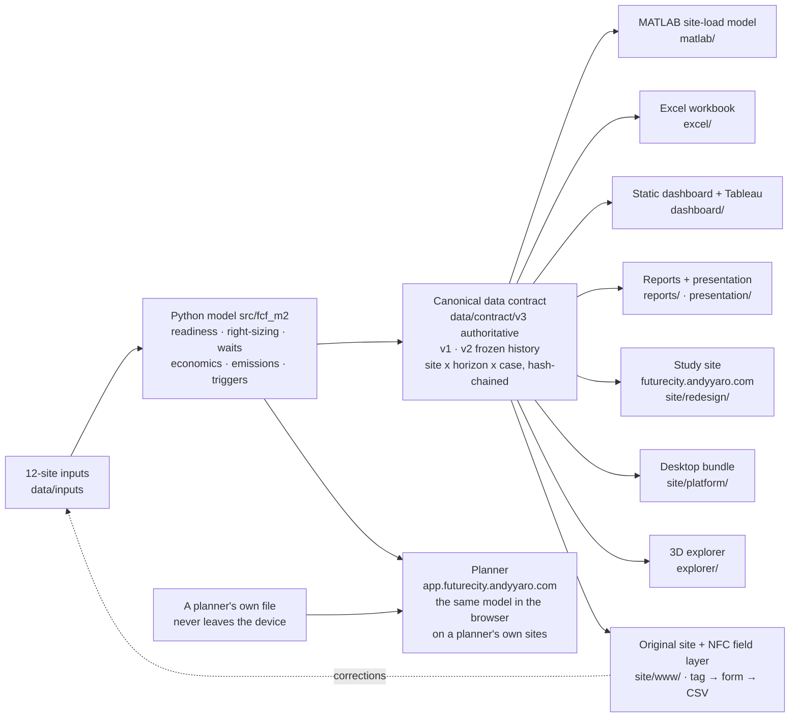

Python is the single producer; MATLAB, Excel, Tableau, both sites, the 3D explorer and every
visual consume the same validated contract, so no two artifacts can disagree about a port
count, a year, or whether capacity is a placeholder (`capacity_basis` travels with every row).
The planner is the one surface that runs the model rather than reading its output: it ships the
unmodified `fcf_m2` package to the browser (Pyodide, DEC-024) and never carries the study's real
inputs (DEC-016). Three surfaces still read the frozen contract v1 until they are rebuilt (DEC-027):
the Excel workbook, the desktop bundle in `site/platform/` and the published Tableau workbook.

The dotted arrow is the point of the whole design: a tapped NFC tag opens a form that feeds
observations back into the inputs, so the study can be corrected by someone standing at the site
rather than only by whoever holds the spreadsheet. The pages and forms are live; the **tags
themselves are not deployed** - placing anything on a public facility needs the facility
manager's consent, and that has not been sought.

## Two model modes

| Mode | Purpose |
|---|---|
| `legacy_v2` | Bit-exact reproduction of the accepted V2 baseline (golden-tested: FFX002 58.8; 25 starter / 48 pathway ports, the earlier result, not the official total) |
| `milestone2_v3` | Canonical: 25 starter / 47 pathway ports (the official totals, DEC-027); 2036/2046/2056 horizons, cohort-independent fixed-anchor scoring, typed data confidence, peak-window + discrete-event waits, lifecycle economics, emissions, equity-aware expansion triggers |

V3 never silently replaces legacy numbers. Where it does replace one, a recorded decision says
so: DEC-027 made the canonical 47-port pathway the official total and 48 the earlier
`legacy_v2` result. See the [migration guide](docs/migration-from-v2.md).

## Quick start

```bash
make setup          # venv + editable install with pinned test extras
make test           # full suite incl. legacy golden tests (reports coverage; the 80% floor
                    #   is enforced by ./scripts/verify.sh and CI, not by this target)
make run-legacy     # reproduce the earlier legacy_v2 result (25/48; official is 25/47).
                    #   Needs the private inputs; without them it runs on the synthetic set
make run-v3         # full V3 run: scores, scenarios, economics, emissions, contract
make validate       # validate contract v3 (authoritative) and the frozen v1/v2
./scripts/verify.sh # every repository verification gate
```

To run the model on another jurisdiction's sites, see **[Running EV-SIENT on your own
sites](docs/INPUT_SCHEMA.md)**: intake reads your file in whatever shape it has, shows what
it would do before anything runs, and `run --cohort` produces the same validated contract.

Requirements: Python 3.11+ (verified on 3.12/3.14). MATLAB R2025b for the `matlab/`
model (**not required** for anything above). The MATLAB suite has been executed on licensed
MathWorks R2025b Update 5 - **49 passed / 0 failed** - but only against a *synthetic* fixture,
never against real site data; see
[matlab/EXECUTION_STATUS.md](matlab/EXECUTION_STATUS.md).

## Repository map

| Path | Contents |
|---|---|
| [`src/fcf_m2/`](src/README.md) | The Python model (scoring, right-sizing, waits, economics, emissions, confidence, triggers, contract) |
| [`data/`](data/README.md) | Site inputs, scoring anchors, provenance, cached GIS boundaries, the contracts (v3 authoritative, v1 and v2 frozen) |
| [`tests/`](tests/README.md) | The test suite incl. golden legacy fixtures and contract validation |
| [`matlab/`](matlab/README.md) | Site-grid load-behavior model (session-based profiles, capacity guard, managed charging) |
| [`excel/`](excel/README.md) | Updated grid-planning workbook with live reconciliation checks |
| [`dashboard/`](dashboard/README.md) | Offline static dashboard (9 visuals) + Tableau patch package |
| [`reports/`](reports/README.md) | Final Milestone 2 report, gap-closure status, risk register, briefs |
| [`presentation/`](presentation/README.md) | Final deck, speaker notes, timing runbook, Q&A backup |
| [`docs/`](docs/README.md) | Architecture, methodology, standards, operations, human-action packages |
| [`scripts/`](scripts/README.md) | Verification harness and artifact builders |
| [`platform/`](platform/README.md) | The planner at app.futurecity.andyyaro.com: the app (`app/`), its assistant proxy (`assistant/`), the public data hub (`hub/`), hosting (`infra/`) and release checks (`tools/`) |
| [`site/redesign/`](site/redesign/README.md) | The study site at futurecity.andyyaro.com (HIG Native design, no build step) |
| `site/` | The other deployed surfaces: the original website and NFC pages (`site/www/`, futurecityfellowship.andyyaro.com) and the desktop bundle (`site/platform/`) |
| [`media/launch-film/`](media/launch-film/README.md) | The 59-second launch film's source: composition, recordings scripts, map flight, 3D laptop, sound design |
| `explorer/` | The 3D site explorer - Cesium viewer, 12 building models, its own ETL |
| `infra/` | The Assistant Lambda behind both sites' Assistant pages (`infra/assistant/`), deployed by `scripts/deploy_assistant.py` |

## Key documents

- **[Final Milestone 2 report](reports/milestone-2/Future_City_Fellowship_Milestone_2_Final_Report.md)** - the integrated project record
- **[Presentation deck (PDF)](presentation/deck/Future_City_Fellowship_Milestone_2_Final.pdf)** + [speaker notes](presentation/deck/Future_City_Fellowship_Milestone_2_Speaker_Notes.md)
- **[Gap-closure status](reports/milestone-2/Milestone_2_Gap_Closure_Status.md)** - all 52 fellowship criteria dispositioned
- **[Standards application matrix](docs/standards/FINAL_STANDARDS_APPLICATION_MATRIX.md)** - UL 2594 + UL 3600 highlighted; adopted-vs-latest editions
- **[Proposed standard concept](docs/standards/PROPOSED_MUNICIPAL_EV_STANDARD_CONCEPT.md)** - fellowship design exercise, not a UL/ULSE proposal
- **[The planner](platform/README.md)** - how app.futurecity.andyyaro.com runs the model on a visitor's own file, and the rules its code keeps
- **[Flexible analysis](docs/FLEXIBLE_ANALYSIS.md)** - the column dictionary, Explore and Your Index: what the planner does with columns the model does not score
- **[Accessibility Conformance Report](docs/accessibility/ACR.md)** - the planner against WCAG 2.1 and 2.2, Levels A and AA; self-assessed, with its evidence
- **[Rank stability](docs/methodology/rank_stability.md)** - how sure each rank is, from one-weight sweeps and 2,000 random weightings
- **[Decisions log](docs/operations/v4-program/DECISIONS.md)** - every decision since the V4 program began, DEC-000 to DEC-030
- **[Reproduction guide](docs/operations/reproduction-guide.md)** · **[Migration from V2](docs/migration-from-v2.md)** · **[Contract v1 → v2](docs/migration-from-v3.md)** · **[Open human actions](docs/operations/open-human-actions.md)**

## Verification

`./scripts/verify.sh` runs **every gate it declares** - 41 as of 2026-10-31, and the live
number is whatever it prints: the pytest suite with a coverage floor, legacy
baseline reproduction, contract rule/schema/hash-chain validation, cross-model reconciliation
against the MATLAB input, generated-docs drift, footer QA on every dashboard visual, secret and
local-path scans, size limits, Markdown link checks, the 3D explorer and its CDN pins, the
Tableau workbook and embed forms, the platform's two tiers and their provenance, field-entry
parity in a real browser, supply-chain digests, packaging constraints,
intake degradation, and a clone-safety check that catches files present here but missing from a
fresh clone. It exits with the number of failures, so a red run is visible in the exit code, not
just in the log.

In this public copy, the five gates that need the study's private inputs report SKIP rather
than FAIL, and so do the tests that need them; everything else runs on the synthetic set (see
[About this repository](#about-this-repository)).

CI runs **the same gates**, on every pull request and every push to `main`
([tests.yml](.github/workflows/tests.yml)) - literally the same, because CI invokes
`verify.sh` rather than keeping a second list of steps in step with the first. There is one
definition of what "green" means. Both the secret scan and the Markdown link check are shared
modules (`scripts/secret_scan.py`, `scripts/check_internal_links.py`) for the same reason.

## Standards and safety boundary

Design intent is governed by **UL 2594** (EVSE safety) and **UL 3600** (circular-economy
measurement), with UL 2231, **NEC Article 625 as adopted in Virginia (2020 NEC via the
2021 USBC)**, the Virginia SFPC, and US Access Board EVSE guidance (rule at NPRM stage
as of July 2026) as essential supporting requirements. Storage and DC-fast-charging
standards are explicitly out of scope (no BESS or DCFC in the plan). All permit,
disconnect-placement, access, and code-edition determinations rest with the local AHJ.

## Known limitations

1. Electrical capacity is a placeholder at 12/12 sites (`capacity_basis = placeholder`).
2. Demand is synthetic and uncalibrated; growth multipliers are provisional conventions.
3. Costs are screening-class benchmarks; emissions rest on labeled assumptions.
4. MATLAB code **now runs on real MathWorks MATLAB** (R2025b Update 5, 49 tests passed / 0 failed, [`matlab/EXECUTION_STATUS.md`](matlab/EXECUTION_STATUS.md)) - but only against a **synthetic** fixture, because the public CI harness must never carry project data. The managed-charging numerics therefore remain unexercised against real capacity, since limitation 1 means no real capacity exists. The Simulink model is now **built** ([run 30296650057](matlab/outputs/run-30296650057/)) but has never been **simulated**, and no number here derives from it.
5. The Tableau workbook **has** been rebuilt, verified and [published](https://public.tableau.com/app/profile/yiguedan.philippe.andy.yaro/viz/EV_Charging_Site_Readiness_M2_Canonical/Milestone2Overview) from the canonical contract. **Four presentation features remain unbuildable** and are named in [CAPABILITY_GAP.md](dashboard/tableau/CAPABILITY_GAP.md): bar-in-bar, two reference lines, dashboard filter scoping, and the 8-point story. It was built from contract v1 before DEC-027, so it still shows the earlier 48-port pathway; so do the Excel workbook and the desktop bundle in `site/platform/` until they are rebuilt from contract v3. Separately, an **older workbook is still live on the same profile carrying superseded numbers** - see [open human actions](docs/operations/open-human-actions.md).
6. Client, team-adoption, AHJ, utility, and funding steps remain open - see [open human actions](docs/operations/open-human-actions.md).

## Project status

Milestone 2 package complete (July 2026); presentation 2026-07-21.

Since then the project has become a running system rather than a document set:

- **The study site** at futurecity.andyyaro.com (October 2026) publishes the twelve-site results
  from contract v3, the four weighted parts behind every score and how stable each rank is.
- **The planner** at app.futurecity.andyyaro.com (October 2026) runs the model in a visitor's
  browser on their own sites. It carries the invented Example City sample only, needs no sign-in
  (the old Cognito-gated `/platform/` path was retired on 2026-10-18, DEC-030), fills gaps from a
  six-state public data hub, describes and ranks the columns the model does not score, writes an
  accessible report and works offline. Its optional assistant runs on OpenAI's `gpt-5.4-mini`
  behind a provider switch (DEC-029 and its addendum), under a hard $5 monthly cap.
- **The launch film** (2026-10-23) shows both, recorded from the live sites; its source is in
  [`media/launch-film/`](media/launch-film/).
- A **3D explorer** and a **static dashboard** read the same contract; an **NFC field layer** is
  built and walked end to end on real hardware, so that someone standing in a car park could send
  a correction back into the model - **no tag has been placed at any site, and no permission to
  place one has been sought**; and an **intake layer** lets another jurisdiction bring its own
  data file without that file quietly scoring better than it should.

None of this changes the epistemics. Capacity is still a placeholder at all twelve sites, and
the next real step is unchanged: client follow-up, utility and facility data requests (which
upgrade `capacity_basis` from placeholder), AHJ conversations, and pilot preparation.

## About this repository

This is the public copy of the project's working repository, published on 31 October 2026.
Every commit keeps its original date and message, from the first on 21 June 2026, so the history
shows the study as it was built. Three things were taken out of every commit first
([DEC-031](docs/operations/v4-program/DECISIONS.md)):

- **The twelve facilities' raw inputs** (occupancy, parking and electrical data), the files built
  from them that carry them, and the stakeholder contact list. They stay private (DEC-016) until
  the facilities' owners agree to their release. The model runs on an invented synthetic set
  instead (DEC-020), and the tests and checks that need the real study say so and are skipped.
  The study's results are not affected: they are published at
  [futurecity.andyyaro.com](https://futurecity.andyyaro.com).
- **Email addresses and account identifiers**, replaced with placeholders.
- **The names of the two people interviewed**, now given by role.

A commit that touched only removed files is kept, empty, so the timeline is complete.

## Team

Anna · Laylas · Andy · Adama · Paula - George Mason University Future City Fellowship,
in consultation with Prince William County's Office of Sustainability and Fire &
Rescue interviewees.

*License: the code is licensed under the [Apache License 2.0](LICENSE) (chosen 2026-10-18). Data files keep the terms stated beside them; see [NOTICE](NOTICE).*
