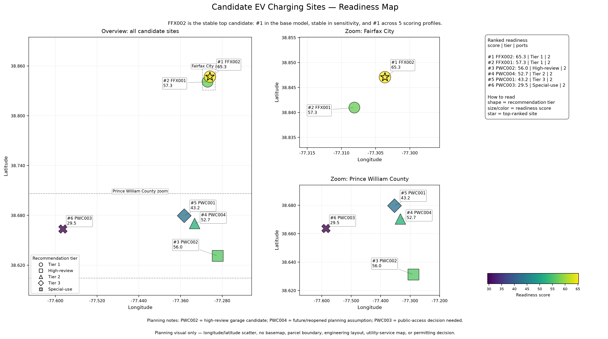
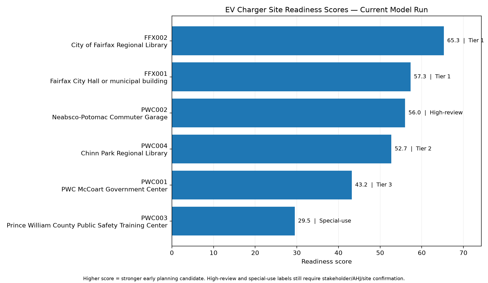
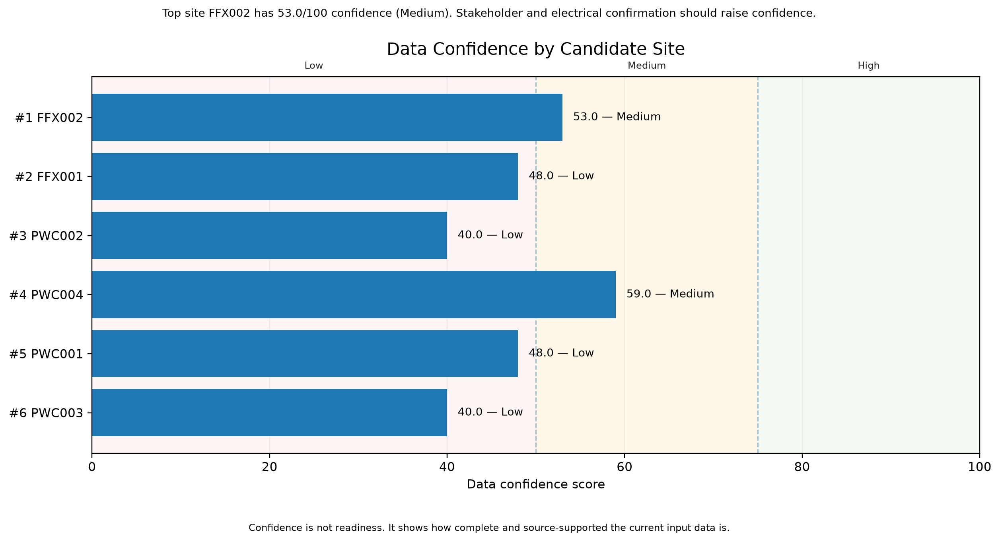
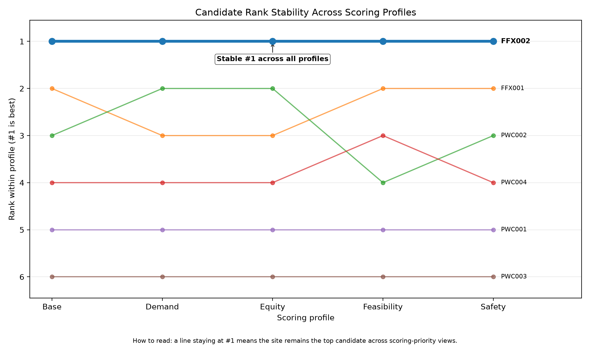
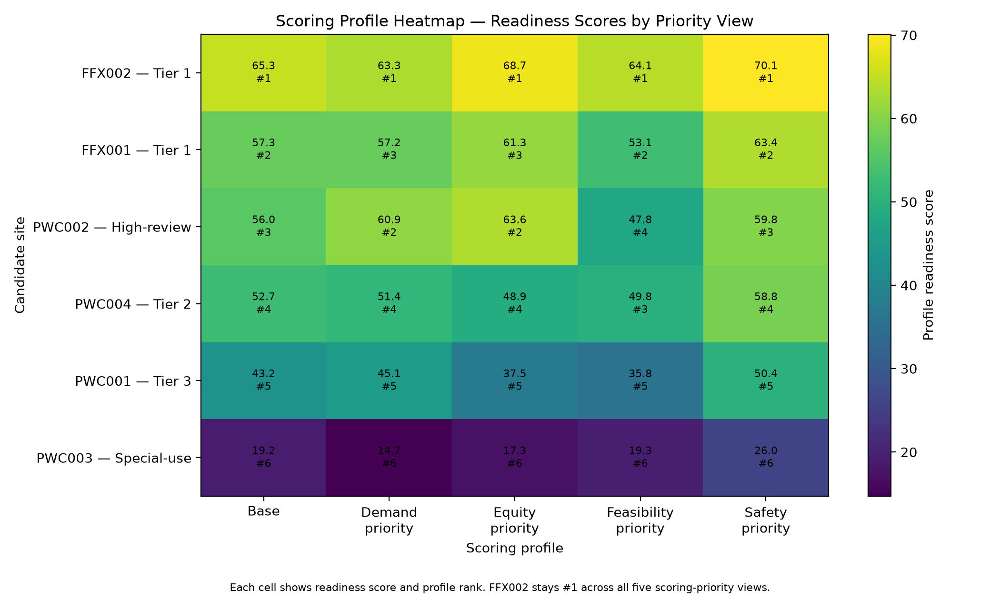

# Model Findings Report

## Project purpose

This prototype is a planning-support model for public EV charging site readiness and right-sizing in Fairfax City and Prince William County.

The model helps answer four questions:

```text
1. Which candidate sites look strongest?
2. How many starter charging ports should be considered?
3. How complete or confirmed is the current data?
4. What should be checked next before a site advances?
```

The model supports early planning. It is not a final approval or construction tool.

## Candidate sites evaluated

```text
PWC001 — PWC McCoart Government Center
PWC002 — Neabsco-Potomac Commuter Garage
PWC003 — Prince William County Public Safety Training Center
PWC004 — Chinn Park Regional Library
FFX001 — Fairfax City Hall or municipal building
FFX002 — City of Fairfax Regional Library
```

## Site readiness map

The map shows the candidate sites, the two geographic clusters, and the current ranked readiness interpretation.



## Scoring method

Each site receives planning subscores for demand, feasibility, safety/site context, and equity.

The final readiness score uses this weighting:

```text
readiness_score = 0.45*demand + 0.30*feasibility + 0.15*safety + 0.10*equity
```

Readiness score shows how promising a site looks under current assumptions. Data confidence is separate and shows how complete or confirmed the input data is.

## Final ranked results

```text
1. FFX002 — City of Fairfax Regional Library — readiness 65.3
2. FFX001 — Fairfax City Hall or municipal building — readiness 57.3
3. PWC002 — Neabsco-Potomac Commuter Garage — readiness 56.0
4. PWC004 — Chinn Park Regional Library — readiness 52.7
5. PWC001 — PWC McCoart Government Center — readiness 43.2
6. PWC003 — Prince William County Public Safety Training Center — readiness 29.5
```



## Data confidence

Data confidence is not the same thing as readiness. It shows how complete and source-supported the current input data is.



## Scoring profile analysis

The project tests whether the ranking changes when different planning priorities are emphasized.

Current profiles:

```text
base
demand_priority
equity_priority
feasibility_priority
safety_priority
```

Latest result:

```text
base — FFX002 ranked #1 with score 65.3
demand_priority — FFX002 ranked #1 with score 63.3
equity_priority — FFX002 ranked #1 with score 68.7
feasibility_priority — FFX002 ranked #1 with score 64.1
safety_priority — FFX002 ranked #1 with score 70.1
```

The rank-stability chart is the main presentation visual because it shows rank movement directly. A line staying at `#1` means the site remains the top candidate across scoring-priority views.



The heatmap remains useful when the reader wants the exact score/rank cell values.



## Recommendation tiers

```text
FFX002 — Tier 1
FFX001 — Tier 1
PWC002 — High-review candidate
PWC004 — Tier 2
PWC001 — Tier 3
PWC003 — Low public-priority / special-use
```

## Readiness-confidence action labels

```text
FFX002 — Verify key data, then advance
FFX001 — Promising, but fix data first
PWC002 — Technical review before advancement
PWC004 — Promising with timeline caveat
PWC001 — Monitor or deprioritize
PWC003 — Special-use decision needed
```

These action labels are more cautious than simple ranking. They combine readiness and data confidence so the project does not treat a high score as permission to build.

## Port-planning result

```text
FFX002 — 2 ports now, 2 by 2035, 2 by 2050
FFX001 — 2 ports now, 2 by 2035, 3 by 2050
PWC002 — 2 ports now, 3 by 2035, 3 by 2050
PWC004 — 2 ports now, 2 by 2035, 2 by 2050
PWC001 — 2 ports now, 2 by 2035, 3 by 2050
PWC003 — 2 ports now, 2 by 2035, 2 by 2050
```

## Cross-checks supporting the result

```text
1. Base model ranking: FFX002 ranked #1.
2. Sensitivity analysis: all six sites had rank_range = 0.
3. Scoring profile analysis: FFX002 ranked #1 across all five scoring profiles.
```

## Remaining data gaps

```text
elec_service_rating_amp
spare_capacity_kw
emergency_disconnect_visible
employees_day
visitors_day
hours_open for sites except FFX002
parking_spaces for sites except FFX002
local EV adoption counts
PWC004 reopening or usable-planning timeline
PWC002 garage-specific review
PWC003 public, fleet-only, special-use, or removal decision
```

## Planning conclusion

FFX002 is the most stable top candidate because it ranks first in the base model, stays stable in sensitivity analysis, and remains first across all scoring profiles. FFX001 is the second strongest candidate. PWC002 and PWC004 remain important candidates but need more confirmation before advancement. PWC003 should stay low priority unless its access or use case changes.

The model should be used to prioritize follow-up questions and site screening, not to authorize construction, procurement, or final site selection.
