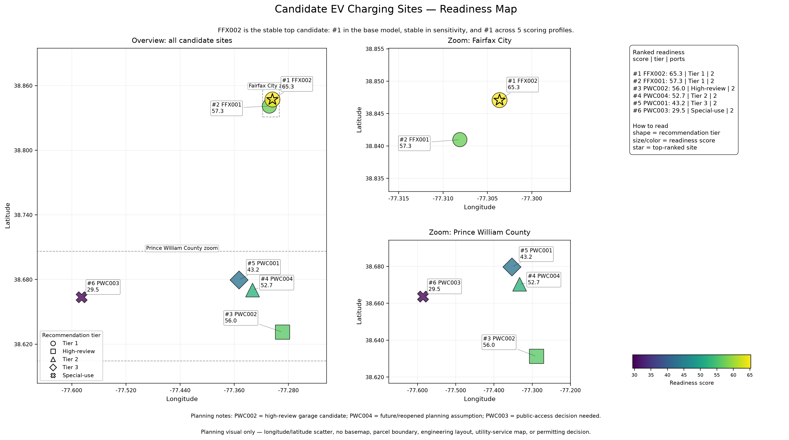

# Readiness Map Guide

The generated readiness map is:

```text
data/outputs/charts/site_readiness_map.png
```

The committed preview used by GitHub Markdown should be synced from the generated chart to:

```text
docs/assets/charts/site_readiness_map.png
```



## What the map shows

The map plots the six candidate EV charging sites by longitude and latitude.

The current version is a multi-panel planning visual:

```text
left panel = overview of all six candidate sites
upper middle panel = zoomed Fairfax City view
lower middle panel = zoomed Prince William County view
right panel = ranked readiness summary
bottom/right colorbar = readiness score scale
```

Each marker represents one candidate site. The map uses several visual cues at the same time:

```text
marker size = readiness score
marker color = readiness score
marker shape = recommendation tier
star overlay = top-ranked site
label = rank, site ID, and readiness score
right-side summary panel = ranked list with score, tier, and recommended ports
```

The overview panel draws light dashed boxes around the site clusters. These boxes are visual grouping aids only. They are not jurisdiction boundaries, parcel boundaries, or engineering areas.

## Current map interpretation

When the full pipeline is run, the map uses the model results, sensitivity summary, and scoring profile results to add a short interpretation note.

For the current V1 run, the expected note is:

```text
FFX002 is the stable top candidate: #1 in the base model, stable in sensitivity, and #1 across 5 scoring profiles.
```

This supports the main project finding that FFX002 is not only the top site under the base model, but also remains strong when uncertainty and stakeholder-priority profiles are tested.

## How to read special cases

```text
PWC002 = high-review garage candidate
PWC004 = future/reopened planning assumption
PWC003 = public-access decision needed
```

These notes are shown because the map is a planning-support visual. A site can look promising in the model while still needing important real-world confirmation.

## Why the zoom panels exist

The six sites are spread across two geographic areas. A single overview map makes the regional spread clear, but it can make nearby labels hard to read.

The Fairfax City and Prince William County zoom panels make the site clusters easier to inspect without requiring a GIS basemap.

## What the map does not show

The map is a planning visual only.

It is not:

```text
a parcel boundary map
an engineering layout
a charger placement plan
a utility-service map
a permitting decision map
a final site-design map
a true GIS basemap
```

Any real charger project would still need site-owner review, utility review, engineering design, accessibility review, permitting, procurement, and stakeholder approval.
